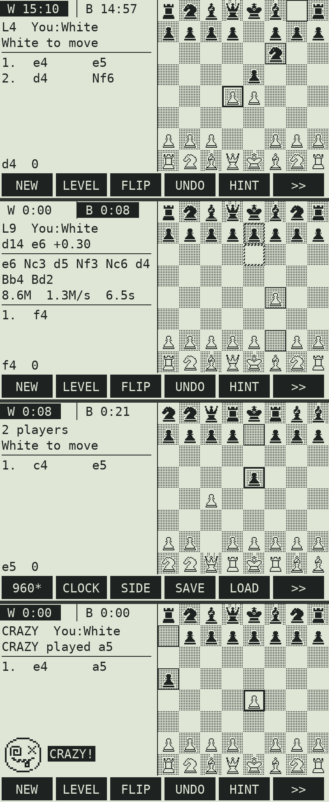
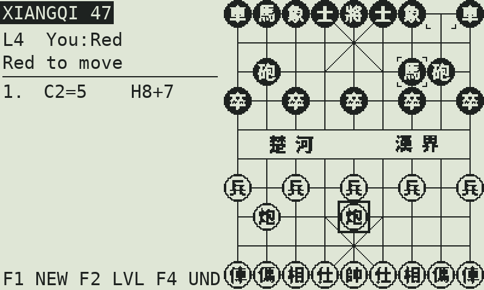
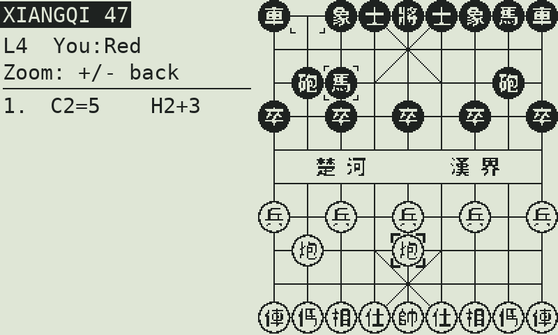
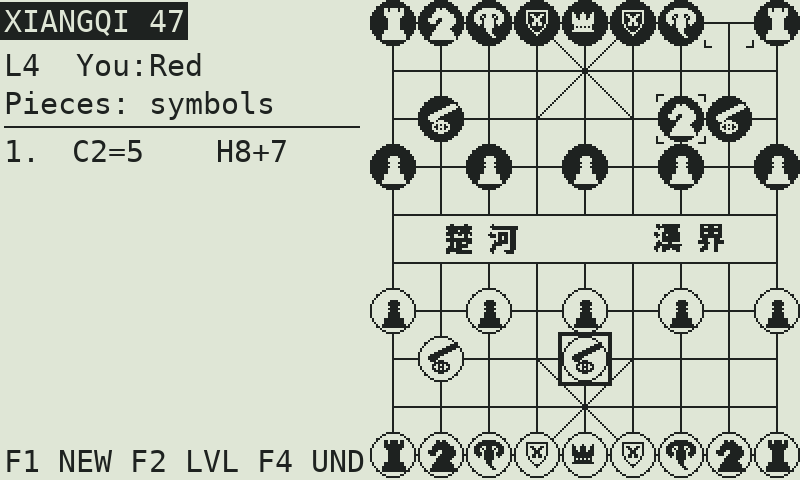
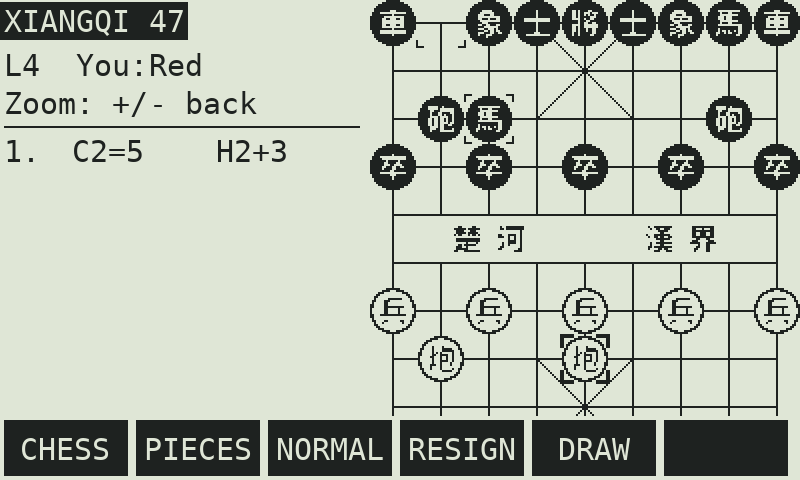
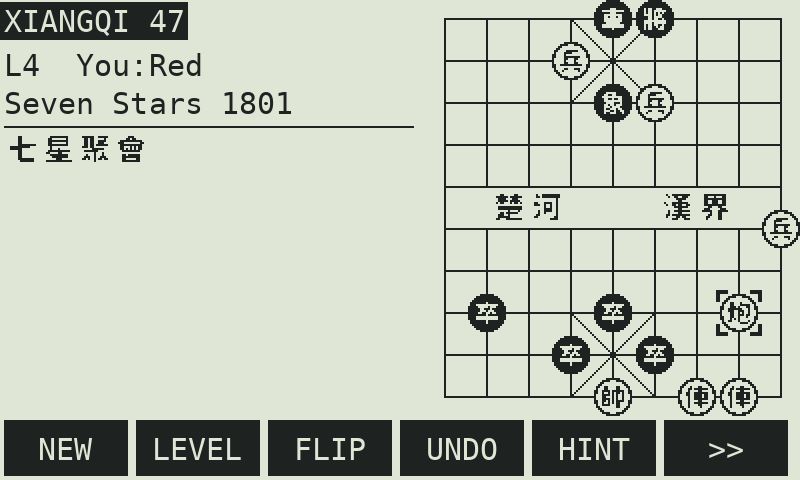
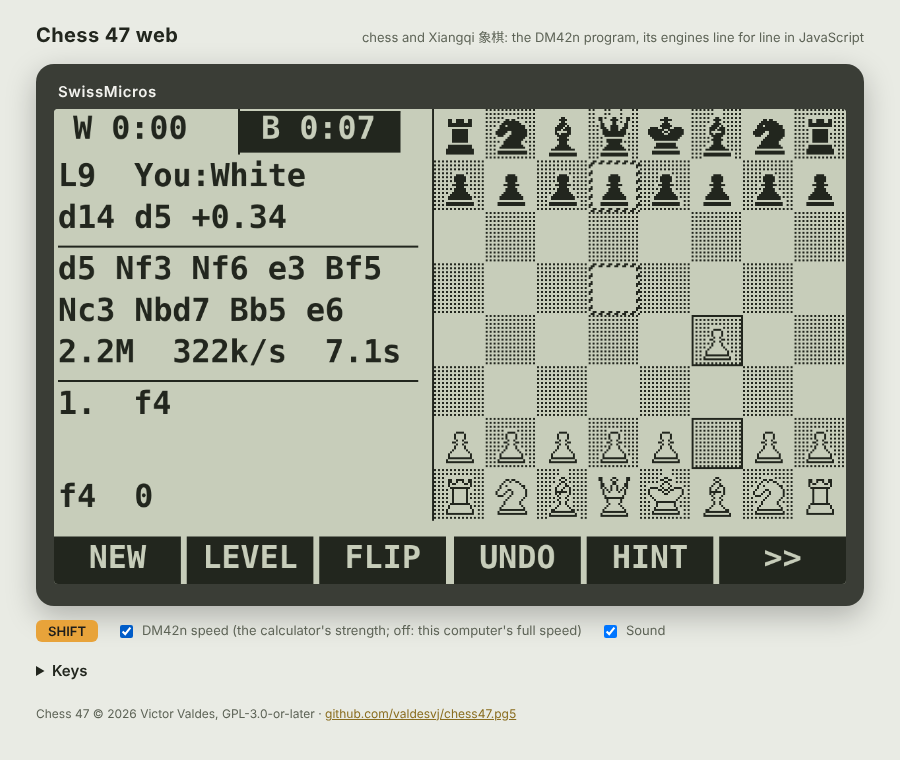
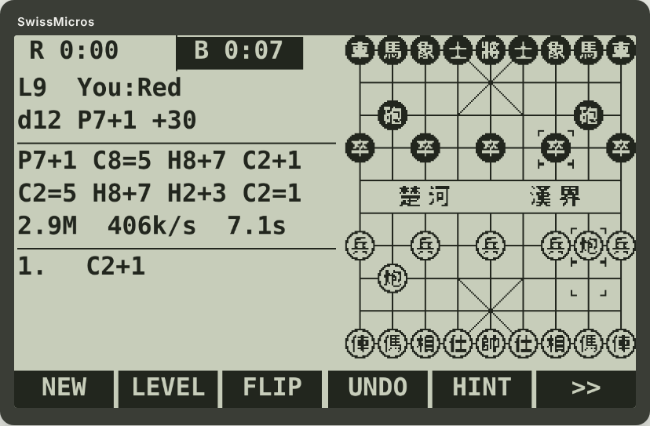

# CHESS 47 — native chess for the SwissMicros DM42n

**CHESS47.pg5** is a stand-alone DMCP5 program written in C for the
SwissMicros **DM42n**. It replaces the calculator program (Free42) with a full
chess machine that has graphic pieces, a chess clock, Chess960, 10 levels
(including **CRAZY**), save/load, PGN export, an on-screen **QR code** of the game,
and USB serial output.

Part of the "47" family of projects (almanac47, chess47, logic47, tide47 …).
This is the native C sister of the RPN `chess47` program for the C47.



## Install on the DM42n

1. **Back up the calculator disk first** (connect USB, copy everything).
2. Copy `release/CHESS47.pg5` to the root of the calculator's USB disk.
   Also keep the current `DM42-x.yy.pg5` from SwissMicros there, so you can go back.
3. Open the DMCP menu: **SETUP → System → Run DMCP**, or press **RESET while holding F1**.
4. Choose **Load program → CHESS47.pg5**.

To return to Free42: in Chess 47 press **SHIFT 0 (SETUP) → System**, or use
**RESET+F1**, then **Load program → DM42-x.yy.pg5**.

> DMCP5 holds one program at a time, so loading Chess 47 replaces Free42 until you
> load the DM42 program again. Your state files on the disk are not touched.

## Xiangqi (Chinese chess), experimental

**SHIFT** opens the game menu, the same in both games: **F1 XIANGQI / CHESS** switches games (each keeps its
own), **F2 PIECES** the pieces' style, **F3 ZOOM**, **F4 RESIGN**, **F5 DRAW**. Xiangqi has the same search as chess
(the shared `src/search.inc`), the same levels, clock and modes (you vs CPU, 2 players, CPU vs CPU), soft keys and
zoom; moves in WXF notation (C2=5, H8+7). The pieces (**×** or SHIFT F2): the traditional characters (Red
帥仕相傌俥炮兵, Black 將士象馬車砲卒, from Noto Sans CJK, thinned to one-pixel strokes), symbols (crown, shield,
elephant, horse, chariot, cannon, soldier: Red grey, a dithered fill, Black white on the disc), or the WXF letters
K A E H R C P. In chess, **×** shows the pieces as letters.

| Normal (soft keys) | Zoom (+ / −) |
|---|---|
|  |  |
|  |  |

Soft keys in Xiangqi: page 1 NEW LEVEL FLIP UNDO HINT, page 2 PIECES CLOCK SIDE, page 3 CHESS MODE INFO.

**SHIFT 7** (七, seven) sets up **七星聚會, the Seven Stars Gathering**: the "king of the endgames", the most famous of
the four great classical compositions (江湖四大名局), as 竹香齋 printed it in 1801. Each side has seven pieces, and
Red moves first. It looks like an easy win for Red, but one wrong move and Black mates. With the best play it is a
draw. The famous line starts 炮二平四 卒5平6 兵四進一 將6進1 俥三進八 (C2=4 P5=6 P4+1 K6+1 R3+8).



- The rules: palace, river, the horse's leg and the elephant's eye, the cannon's screen, the facing generals; no
  legal move loses (stalemate too); repetition is a draw (the real perpetual check / chase rules are not modelled);
  60 moves without a capture a draw.
- Checked: perft from the start = the published counts (44, 1 920, 79 666, 3 290 240, 133 312 995), and perft and
  WXF on 120 random positions = Fairy-Stockfish (`make xq-test`, with pyffish: on Arch in a venv,
  `python -m venv ~/opt/venv-xq && ~/opt/venv-xq/bin/pip install pyffish`, then `make xq-test PYTHON=~/opt/venv-xq/bin/python`;
  or without Python modules, perft only, against Pikafish: `make xq-test XQ_ENGINE=~/opt/Pikafish/src/pikafish`).
- Not yet: Xiangqi over USB (Pikafish, Pychess), SAVE / LOAD; the strength not measured (Pikafish matches to come).
- The pieces are made by `tools/xq_pieces.py` (Pillow, Noto Sans CJK, DejaVu Sans) into `src/xq_pieces.h`.

## Keys

| Key | Action |
|---|---|
| **8 / 2 / 4 / 6** (and ▲ ▼) | move the cursor up / down / left / right |
| **7 9 1 3** | move the cursor diagonally |
| **ENTER** or **5** | select a piece / play the move |
| **EXIT** | cancel the selection; while the CPU thinks: *move now* |
| **←** (backspace) | take back (two plies vs the CPU) |
| **F1…F6** | soft keys (3 pages, `>>` switches page) |
| **+** or **−** | zoom: the board the full screen height (30 px squares), the soft keys hidden (they still work); again: the normal view |
| **SHIFT** | the game menu on the soft keys (also in the zoom): F1 XIANGQI / CHESS, F2 PIECES, F3 ZOOM, F4 RESIGN, F5 DRAW; **SHIFT 7** the Seven Stars (Xiangqi) |
| **×** | the pieces: figures / letters (Xiangqi: characters / symbols / letters) |
| **SHIFT EXIT** | power off. The game is autosaved and resumed at power on |
| **SHIFT 0** | setup: time/date, beep, USB disk, **System**, About |
| **SHIFT ←** | resign at once |
| **SHIFT F4** RESIGN | resign (press SHIFT F4 twice). Against the CPU you resign; with 2 players the side to move |
| **SHIFT F5** DRAW | offer a draw. The CPU accepts when it is worse, or from move 20 when it is not better. With 2 players the other side sees **ACCEPT** on F5 on its turn (press twice); a move declines |
| **NEW** in a game | against the CPU an unfinished game counts as resigned: NEW twice (the result shows), NEW again for the next game |
| **SHIFT Σ+** | info screen |

Castling: select the king, then press on the **rook**. In classic games you can
also press on the king's destination square. Promotion asks Queen/Rook/Bishop/Knight.

### Soft keys

| Page | F1 | F2 | F3 | F4 | F5 | F6 |
|---|---|---|---|---|---|---|
| 1 | NEW | LEVEL | FLIP | UNDO | HINT | >> |
| 2 | 960 | CLOCK | SIDE | SAVE | LOAD | >> |
| 3 | PGN | MODE | QR | USB | INFO | >> |

* **LEVEL**: CRAZY (random legal moves, with the crazy emoticon), then 1–3 (fixed shallow
  depth plus randomness) and 4–9 (0.5 s → 30 s per move). Levels 4+ use a small opening book.
* **960**: type a Chess960 position number 0–959 and press ENTER. ENTER alone picks a random one.
  NEW then deals another random 960 position.
* **CLOCK**: OFF, 1+0, 3+2, 5+0, 10+0, 15+10, 30+0, 60+0, shown at the top left.
  The clock pauses while the calculator is off. The CPU manages its own time.
* **MODE**: You vs CPU / 2 players / CPU vs CPU demo / You vs USB / CPU vs USB (below). **SIDE** swaps colours.
* **SAVE/LOAD**: `/CHESS47/GAME.TXT`. **PGN** writes `/CHESS47/GAME.PGN`
  (with `[Variant "Chess960"]` and `[FEN]` tags when needed).
* **QR**: shows the game as a QR code. Scan it with your phone and paste it into the
  lichess analysis board.
* **USB**: turns the USB serial port on. Every move is sent as UCI text (see below), and every screen as a frame for `tools/dm42view.py` (the screen in your terminal).

## Messages

The status line always shows the game's state first: **CHECK!** (inverted) as soon as a king is attacked, even
while the computer thinks. At the end a box on the board says what happened, why, and the result:
**CHECKMATE**, **STALEMATE**, **DRAW** (50-move rule, no mating material, 3-fold repetition, agreed), **TIME** (a flag
fell), **RESIGNS**. With USB on, the result also goes to the PC as a `result 1-0 ...` line.

## Strength (measured against Stockfish)

Chess 47 (PC build, same engine) against **Stockfish 16** with `UCI_LimitStrength`
at a fixed `UCI_Elo` and 100 ms per move. Chess 47 got a **fixed node budget** per move
to imitate the calculator's speed. Each match is 20 games with alternating colours
and varied openings (random start positions for Chess960). Script: `test/run_matches.sh`.

| Imitates on the DM42n | Nodes/move | vs Stockfish | Result | Score | Est. Elo |
|---|---:|---:|---|---:|---:|
| level 6–7, battery (80 MHz) | 25 000 | 1600 | +15 =2 −3 | 80% | ~1840 |
| level 6–7, battery (80 MHz) | 25 000 | 2000 | +5 =4 −11 | 35% | ~1890 |
| level 7–8, USB power (160 MHz) | 100 000 | 2000 | +13 =4 −3 | 75% | ~2190 |
| level 7–8, USB power (160 MHz) | 100 000 | 2400 | +6 =6 −8 | 45% | ~2365 |
| **Chess960**, USB power | 100 000 | 2200 | +4 =7 −9 | 38% | ~2110 |
| level 9 (30 s), USB power | 400 000 | 2400 | +7 =8 −5 | 55% | ~2435 |

**Level 9 again (November 2026, `--level 9`, Stockfish on Arch Linux):**

| Imitates on the DM42n | Nodes/move | vs Stockfish | Result | Score | Est. Elo (95%) |
|---|---:|---:|---|---:|---:|
| level 9, USB power | 400 000 | 2200 | +9 =6 −5 | 60% | ~2270 (2145–2418) |
| level 9, USB power | 400 000 | 2400 | +11 =3 −6 | 62% | ~2489 (2351–2663) |
| level 9, USB power, **60 games** | 400 000 | 2400 | +36 =11 −13 | 69% | ~2540 (2462–2636) |
| **level 9, USB power: all 100 games** | 400 000 | 2200 + 2400 | 66 / 100 | 66% | **~2480 (±75)** |
| level 9, battery | 300 000 | 2200 | +9 =2 −9 | 50% | ~2200 (2046–2354) |
| level 9, **Chess960**, USB power | 400 000 | 2200 | +12 =3 −5 | 68% | ~2330 (2192–2518) |

The combined line is the maximum-likelihood rating over the three matches (100 games). To repeat:
`python3 test/match.py --level 9 --nodes 400000 --elo 2400 --games 60`.

**Xiangqi** (November 2026): the Xiangqi engine (`build/xq-uci`, the DM42n's node budget) against
**Fairy-Stockfish** at a fixed `UCI_Elo`, 100 ms a move, refereed by pyffish (Fairy-Stockfish's rules: perpetual
check and chasing included), 12 openings with both colours. Script: `test/xq_match.py`.

| Imitates on the DM42n | Nodes/move | vs Fairy-Stockfish | Result | Score |
|---|---:|---:|---|---:|
| levels 7–8, USB power | 100 000 | 1600 | +19 =0 −1 | 95% |
| levels 7–8, USB power | 100 000 | 2000 | +10 =2 −8 | 55% |
| levels 7–8, USB power | 100 000 | 2400 | +0 =0 −20 | 0% |
| level 9, USB power | 400 000 | 2000 | +9 =3 −8 | 52% |
| level 9, USB power | 400 000 | 2200 | +1 =0 −19 | 5% |
| level 9, USB power | 400 000 | 2400 | +3 =0 −37 | 8% |

**About 2000 on Fairy-Stockfish's scale, at 100 000 and at 400 000 nodes alike** (maximum likelihood: 100 000
nodes ~2000, 95% 1880–2120; 400 000 nodes ~1940, 95% 1830–2040). Read it with care:
* Fairy-Stockfish's `UCI_Elo` is calibrated for chess. In Xiangqi its scale is far steeper: even at 2000, nearly
  hopeless at 2200. So these are not official Xiangqi ratings, only a place on Fairy-Stockfish's ladder.
* Four times the nodes gained nothing here (in chess about 250 points): the search is not the limit, the simple
  evaluation is (material, a few square bonuses, the guards). Mobility, attacks on the general and the
  cannon/horse coordination are where Xiangqi would get stronger.
* In words: a good club player, as in chess.

To repeat:

```bash
gcc -O2 -o build/xq-uci test/xq_uci.c src/engine.c src/xq_engine.c
python3 test/xq_match.py --fairy ~/opt/Fairy-Stockfish/src/stockfish --nodes 400000 --elo 2000 --games 20
```

Needs pyffish (`python -m venv ~/opt/venv-xq && ~/opt/venv-xq/bin/pip install ~/opt/Fairy-Stockfish`) and
Fairy-Stockfish built with `largeboards=yes`.

**Roughly 1850 on battery at the middle levels, 2200–2300 on USB power, about 2480 at level 9 on USB power (about 2200 on battery).**

Please read these as rough estimates:
* 20 games per match means about ±100 Elo of statistical error.
* Stockfish's `UCI_Elo` is calibrated at longer time controls. At 100 ms per move it plays
  somewhat below its nominal rating, so the absolute numbers are probably **optimistic by
  100–200 points**. Treat it as a strong club player, not a master.
* The DM42n speed (~10k / ~19k nodes/s) is estimated from instruction counts, not measured
  on hardware yet. The calculator's INFO screen shows the real nodes/s after a search.


## Stockfish on Linux over USB (both ways)

MODE (menu page 3) has **You vs USB**: the other side is played by a program on the PC, over the USB serial port
(MODE switches USB on). SIDE chooses your colour. The calculator sends `newgame <FEN>`, `opponent white|black` and
every move (`e2e4`); the PC answers with its move (`e7e5`), which the calculator checks, plays and sends back as the
confirmation (`illegal ...` / `notyourturn` otherwise). `msg <text>` shows a text in the status line.

```bash
sudo pacman -S stockfish python-chess
python3 tools/usb_stockfish.py --elo 2000 --time 2      # finds the DM42n by name; Stockfish plays the USB side
python3 tools/usb_stockfish.py --manual                  # the old way: you type Stockfish's move ("2 players")
```

### Lichess: the DM42n as your board

`tools/lichess_board.py` connects "You vs USB" to Lichess's **Board API**: you play your moves on the calculator, they
go to Lichess as yours, and your opponent's come back to the board. The PC also sends `newgame white|black [FEN]`
(the calculator starts that game, your side at the bottom), `play <move>` (to catch up a game in progress) and
`msg` lines (the opponent and the clocks). Hints are off in "You vs USB": in games as yourself only you choose the
moves (Lichess fair play; engines play only on BOT accounts).

The screen while you play: only one program can have the port, so the bridge shows it itself (both bridges):

```bash
python3 tools/lichess_board.py --ai 3 --view                  # the screen in this terminal, the moves under it
python3 tools/lichess_board.py --ai 3 --screen /tmp/dm42.png  # a PNG on every change; elsewhere: feh -R 0.5 /tmp/dm42.png
python3 tools/lichess_board.py --ai 3 --view --keys           # and the PC keyboard types on the calculator
```

The bridges wait for the calculator when its port is not there (USB off, the cable out), and when the port closes
during a game they wait for it again (a new /dev/ttyACM* too) and put the game back on the calculator: the Lichess
game and its clock go on meanwhile. Ctrl+C quits.

When the PC starts a game, the calculator's menu goes to page 1 (F4 RESIGN, F5 DRAW). During a USB game the USB key
(page 3) does not switch USB off.

During a game vs USB, menu page 1 has the game's own actions in place of UNDO and HINT (Lichess's rules):

| Key | Action |
|---|---|
| **F4 RESIGN** | resign (press twice); **ABORT** (twice) before each side has moved |
| **F5 DRAW** | offer a draw (**DRAW\*** while it waits; the opponent's move declines it) |
| **F5 ACCEPT** | the opponent offers a draw (a beep): press twice to agree; **BSP** declines, and so does your next move |
| **F5 CLAIM** | the opponent left the game and Lichess lets you claim the win |
| **SHIFT BSP** | resign at once |

Against `usb_stockfish.py` the same keys work: RESIGN and ABORT end the game, and Stockfish agrees to a draw
only when its evaluation is not better than equal. The lines: the calculator sends `resign`, `abort`,
`draw offer|accept|decline`, `claim`; the PC sends `drawoffer`, `drawoffer off`, `drawdeclined`, `claim on|off`
(`test/test_usb_actions.py` checks them in the simulator).

```bash
mkdir -p ~/.config/chess47      # a token with the scope "Play games with the board API" (board:play):
echo 'lip_...' > ~/.config/chess47/lichess.token && chmod 600 ~/.config/chess47/lichess.token
python3 tools/lichess_board.py --ai 3           # against Lichess's computer (levels 1-8)
python3 tools/lichess_board.py --seek           # a casual 15+10 game against a person
python3 tools/lichess_board.py --challenge NAME # a friend
```

### Lichess: Chess 47 as a BOT (the calculator thinks)

**CPU vs USB**: the calculator's own engine plays one side and the USB the other. `lichess_board.py --bot` puts it on
a Lichess **BOT account**: it accepts challenges (or sends one), the calculator thinks every move and the bridge sends
it to Lichess. Before each of its moves the PC sends the game's clock (`clock <ms left> <increment ms>`); the engine
uses about 1/30 of its time, never more than its level's time (level 9: 30 s). The PC also sends `level N`,
`botgame white|black [FEN]` (the engine's side), `play` lines to catch up, `go` (the engine may move) and
`end <reason> <result>` when the game ends on Lichess (resignation, time, abort).

A BOT account is a **new** Lichess account that has never played a game, upgraded once (it can't be undone, so not
your own account), with a token of the scope **bot:play**:

```bash
echo 'lip_...' > ~/.config/chess47/bot.token && chmod 600 ~/.config/chess47/bot.token
curl -d '' https://lichess.org/api/bot/account/upgrade -H "Authorization: Bearer $(cat ~/.config/chess47/bot.token)"
# on the DM42n: Chess 47, USB on (page 3, F4)
python3 tools/lichess_board.py --bot --token ~/.config/chess47/bot.token                  # accept challenges
python3 tools/lichess_board.py --bot --token ~/.config/chess47/bot.token --challenge NAME  # challenge someone
#   --level 0-9 (default 9)   --speeds blitz,rapid,classical,correspondence (the challenges accepted)
```

Keep the DM42n on USB power (the engine is about twice as fast). Bullet is declined by default: the USB and the
network take about a second a move. For a bot without the calculator (the same engine on the PC), use
`build/chess47-uci` with [lichess-bot](https://github.com/lichess-bot-devs/lichess-bot).


## The USB: DMCP5's serial console, from DMCP5 3.58 or over TinyUSB

Two builds, **the same stream to the PC** (SwissMicros' preliminary "DMCP5 Serial Console API", IFC 3.18), so the
same tools and commands work with both:

| build | runs the USB | needs | the calculator while USB is on |
|---|---|---|---|
| `make` (USB=sercon) | DMCP5 3.58 itself | DMCP5 3.58 (the .pg5 has IFC 18; an older DMCP5 refuses to load it) | sleeps; a 100 ms timer wakes it to read the PC's lines |
| `make USB=tinyusb` | Chess 47, with **TinyUSB** (`src/usb/`, `third_party/tinyusb`, MIT) | any DMCP5 | does not sleep (it would stop the USB) |

USB on turns on the console and its LCD stream, and gives your DMCP settings back when it goes off.
* The moves and the other lines (`newgame`, `opponent`, `result` ...) go on **channel 2**, whole lines, at most
  128 bytes a write (the data sheet: longer or quick writes can lose their ends); the PC's lines come on channel 2
  too. The PC tools add the byte `0x12` before each line and keep only channel 2 (`tools/dm42port.py`).
* The screen: the changed LCD rows on channel 0; when the PC asks for the whole screen (`L`), Chess 47 gets the key
  code 77 and redraws. The PC's keys (`KPhh` / `KR`) come as real keys (`--keys` in the tools).
* `src/sercon.c` is the program side in both builds; `src/sercon_ifc.h` has the three calls, from the data sheet
  (replace with the official 3.58 headers when you have them).
* In the TinyUSB build `src/usb/usbcon.c` **plays DMCP's serial console** over our own port (the firmware's
  `usb_acm_on()` leaves the DM42n's USB core in soft-disconnect): the same channels, FIFOs and overflow rules, the same
  `V`, `KPhh`/`KR`/`K hh` and `L`, the same LCD rows. On purpose it differs only in: `V` answers `DMCP5 TinyUSB`, `B`
  (DFU) is ignored, no key reports (DMCP5 has no call for programs to read the keys held), and a write waits for the
  PC instead of losing its end. `make test-usb` checks it on the PC against the data sheet; the simulator gives the
  same `acm.out` with both (`make sim`, `make sim USB=tinyusb`), and `test/test_usb_actions.py` passes with both.
  When DMCP5 3.58 is released, plain `make` is all that changes.

`make both` builds the two side by side: `build/CHESS47.pg5` (DMCP5 3.58) and `build/tinyusb/CHESS47.pg5` (any DMCP5).

`tools/usb_stockfish.py`, `tools/lichess_board.py` and `tools/dm42view.py` work with both builds:

```bash
python3 tools/dm42view.py                 # the screen: Braille dots in the terminal
python3 tools/dm42view.py --png shots/    # and a PNG of every screen
```

## In the browser (web/chess47.html)

`web/chess47.html` is Chess 47 in one file for any browser, phone included, offline too: chess and Xiangqi, the
same screen, soft keys, levels, piece styles, zoom and SHIFT game menu (Shift pressed alone, or the SHIFT button),
and the engines of `src/engine.c` and `src/xq_engine.c` ported line for line to JavaScript (`web/engine.js`,
`web/xq_engine.js`, in a Web Worker so the page stays responsive). SHIFT 7 (or Shift+7) the Seven Stars. Click or tap a piece, then its square; F1-F6 and the keypad keys work
as on the calculator. With **DM42n speed** (on by default) the engine searches as many positions as the DM42n on
USB power would in the same time, so the levels keep the calculator's strength; off, it uses the computer's
full speed. The game is kept in the browser and resumed; PGN downloads the game, FEN copies the position.
Chess960 and its number 1701 work too.

 

The port is checked against the C: `test/test_web.js` compares perft counts, Zobrist keys, FEN, and fixed-depth
searches (best move, score, node count, with the weak levels' root noise) with `test/jscheck.c`:

```bash
gcc -O2 -o build/jscheck test/jscheck.c src/engine.c && node test/test_web.js
gcc -O2 -o build/xq_jscheck test/xq_jscheck.c src/engine.c src/xq_engine.c && node test/test_web_xq.js
python3 tools/build_web.py      # web/app.html + the engines + app.js + the bitmaps -> web/chess47.html
```

## Build

Requirements: `arm-none-eabi-gcc` (Debian/Ubuntu: `apt install gcc-arm-none-eabi libnewlib-arm-none-eabi`), `make`, `python3`.

```bash
make            # -> build/CHESS47.pg5
make test       # PC: perft (move generator incl. Chess960) + search tests
```

`tools/pg5tool.py` replaces the SDK's bash helpers. It writes the QSPI CRC header,
then packs the `.pg5`: program size word plus SHA1 trailer.

### PC simulator and UCI engine

```bash
# simulator: real main.c + engine.c against a fake DMCP layer, renders the LCD
make sim                    # USB = DMCP's serial console (test/sim/sercon_sim.c); USB=tinyusb: src/usb/usbcon.c
cd build && ./sim 5 8 8 5 WAIT:2000 SNAP:shot && python3 ../test/sim/render.py shot shot.png
# the USB: ./acm.out (what the calculator sends), ./acm.in (the PC's lines; ACM_FREE=1: whenever asked);
# HOSTL in the key script = the PC sends L (the whole screen)
python3 tools/dm42view.py acm.out --once --png .

# UCI engine (for cutechess, Arena, or the Elo test)
gcc -O2 -o build/chess47-uci test/uci.c src/engine.c
GAMES=20 test/run_matches.sh
```

## Inside

| | |
|---|---|
| Board | 0x88, copy-make, Zobrist hashing |
| Moves | fully legal, en passant, promotions, **Chess960 castling** (X-FEN/Shredder-FEN), perft-verified |
| Search | iterative deepening, PVS alpha-beta, transposition table, null move, LMR, check extension, killers + history, quiescence with delta pruning, repetition/50-move detection |
| Eval | material + piece-square tables (tapered), mobility, pawn structure (passed/doubled/isolated), rooks on open files, bishop pair, development, king pawn shield |
| Memory | 2.4 KB of the 8 KB static RAM. Everything else (≈85 KB engine + hash table sized from free heap + 70 KB game history) is on the heap |
| Speed | about 5,000 instructions per node, so an estimated ~10k nodes/s on battery (80 MHz) and ~19k nodes/s on USB power (160 MHz) |

Files: `src/engine.c` (portable engine), `src/main.c` (DMCP5 UI), `src/pieces.h` (bitmaps),
`test/` (perft, simulator, UCI, match), `tools/` (pg5 packer, USB-Stockfish bridge).

## License

Written with the help of AI. See `AI_ASSISTANCE.md` for how it was used and checked.

GPL-3.0-or-later © 2026 Victor Valdes. `dmcp/` and `stm32_program.ld` are from the SwissMicros
DMCP5 SDK (BSD-3, released "NOMAS": not manufacturer supported). Please don't
contact SwissMicros about this program.
