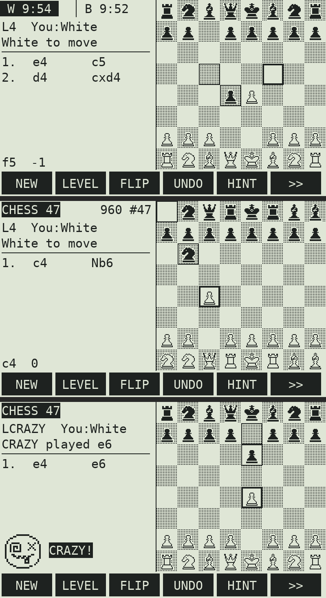

# CHESS 47 — native chess for the SwissMicros DM42n

**CHESS47.pg5** is a stand-alone DMCP5 program written in C for the
SwissMicros **DM42n**. It replaces the calculator program (Free42) with a full
chess machine that has graphic pieces, a chess clock, Chess960, 10 levels
(including **CRAZY**), save/load, PGN export, an on-screen **QR code** of the game,
and USB serial output.

Part of the "47" family of projects (almanac47, chess47, logic47, tide47 …).
This is the native C sister of the RPN `chess47` program for the C47.



## Install on the DM42n

1. **Back up the calculator disk first** (connect USB, copy everything).
2. Copy `release/CHESS47.pg5` to the root of the calculator's USB disk.
   Also keep the current `DM42-x.yy.pg5` from SwissMicros there, so you can go back.
3. Open the DMCP menu: **SETUP → System → Run DMCP**, or press **RESET while holding F1**.
4. Choose **Load program → CHESS47.pg5**.

To return to Free42: in Chess 47 press **SHIFT 0 (SETUP) → System**, or use
**RESET+F1**, then **Load program → DM42-x.yy.pg5**.

> DMCP5 holds one program at a time, so loading Chess 47 replaces Free42 until you
> load the DM42 program again. Your state files on the disk are not touched.

## Keys

| Key | Action |
|---|---|
| **8 / 2 / 4 / 6** (and ▲ ▼) | move the cursor up / down / left / right |
| **7 9 1 3** | move the cursor diagonally |
| **ENTER** or **5** | select a piece / play the move |
| **EXIT** | cancel the selection; while the CPU thinks: *move now* |
| **←** (backspace) | take back (two plies vs the CPU) |
| **F1…F6** | soft keys (3 pages, `>>` switches page) |
| **SHIFT EXIT** | power off. The game is autosaved and resumed at power on |
| **SHIFT 0** | setup: time/date, beep, USB disk, **System**, About |
| **SHIFT ←** | resign |
| **SHIFT Σ+** | info screen |

Castling: select the king, then press on the **rook**. In classic games you can
also press on the king's destination square. Promotion asks Queen/Rook/Bishop/Knight.

### Soft keys

| Page | F1 | F2 | F3 | F4 | F5 | F6 |
|---|---|---|---|---|---|---|
| 1 | NEW | LEVEL | FLIP | UNDO | HINT | >> |
| 2 | 960 | CLOCK | SIDE | SAVE | LOAD | >> |
| 3 | PGN | MODE | QR | USB | INFO | >> |

* **LEVEL**: CRAZY (random legal moves, with the crazy emoticon), then 1–3 (fixed shallow
  depth plus randomness) and 4–9 (0.5 s → 30 s per move). Levels 4+ use a small opening book.
* **960**: type a Chess960 position number 0–959 and press ENTER. ENTER alone picks a random one.
  NEW then deals another random 960 position.
* **CLOCK**: OFF, 1+0, 3+2, 5+0, 10+0, 15+10, 30+0, 60+0, shown at the top left.
  The clock pauses while the calculator is off. The CPU manages its own time.
* **MODE**: You vs CPU / 2 players / CPU vs CPU demo. **SIDE** swaps colours.
* **SAVE/LOAD**: `/CHESS47/GAME.TXT`. **PGN** writes `/CHESS47/GAME.PGN`
  (with `[Variant "Chess960"]` and `[FEN]` tags when needed).
* **QR**: shows the game as a QR code. Scan it with your phone and paste it into the
  lichess analysis board.
* **USB**: turns the USB serial port on. Every move is sent as UCI text (see below).

## Strength (measured against Stockfish)

<!--ELO-->

## Stockfish on Linux over USB

The DMCP5 API can **send** over USB serial (`acm_puts`), but it has **no receive function**.
I checked all 201 entries of the system call table. So the link is one-way:

```
DM42n  --(moves, "newgame <FEN>")-->  /dev/ttyACM0  -->  tools/usb_stockfish.py  -->  Stockfish
                                                          (you type its reply on the keypad)
```

```bash
pip install chess
python3 tools/usb_stockfish.py /dev/ttyACM0 --elo 2000 --time 2 --side black
```

On the calculator, set MODE to "2 players" and turn USB on (page 3).

## Build

Requirements: `arm-none-eabi-gcc` (Debian/Ubuntu: `apt install gcc-arm-none-eabi libnewlib-arm-none-eabi`), `make`, `python3`.

```bash
make            # -> build/CHESS47.pg5
make test       # PC: perft (move generator incl. Chess960) + search tests
```

`tools/pg5tool.py` replaces the SDK's bash helpers. It writes the QSPI CRC header,
then packs the `.pg5`: program size word plus SHA1 trailer.

### PC simulator and UCI engine

```bash
# simulator: real main.c + engine.c against a fake DMCP layer, renders the LCD
gcc -O2 -w '-D__packed=__attribute__((__packed__))' '-D__weak=__attribute__((weak))' \
    -Itest/sim -Isrc -o build/sim test/sim/sim.c src/main.c src/engine.c
cd build && ./sim 5 8 8 5 WAIT:2000 SNAP:shot && python3 ../test/sim/render.py shot shot.png

# UCI engine (for cutechess, Arena, or the Elo test)
gcc -O2 -o build/chess47-uci test/uci.c src/engine.c
GAMES=20 test/run_matches.sh
```

## Inside

| | |
|---|---|
| Board | 0x88, copy-make, Zobrist hashing |
| Moves | fully legal, en passant, promotions, **Chess960 castling** (X-FEN/Shredder-FEN), perft-verified |
| Search | iterative deepening, PVS alpha-beta, transposition table, null move, LMR, check extension, killers + history, quiescence with delta pruning, repetition/50-move detection |
| Eval | material + piece-square tables (tapered), mobility, pawn structure (passed/doubled/isolated), rooks on open files, bishop pair, development, king pawn shield |
| Memory | 2.4 KB of the 8 KB static RAM. Everything else (≈85 KB engine + hash table sized from free heap + 70 KB game history) is on the heap |
| Speed | about 5,000 instructions per node, so an estimated ~10k nodes/s on battery (80 MHz) and ~19k nodes/s on USB power (160 MHz) |

Files: `src/engine.c` (portable engine), `src/main.c` (DMCP5 UI), `src/pieces.h` (bitmaps),
`test/` (perft, simulator, UCI, match), `tools/` (pg5 packer, USB-Stockfish bridge).

## License

MIT © 2026 Victor Valdes. `dmcp/` and `stm32_program.ld` are from the SwissMicros
DMCP5 SDK (BSD-3, released "NOMAS": not manufacturer supported). Please don't
contact SwissMicros about this program.
